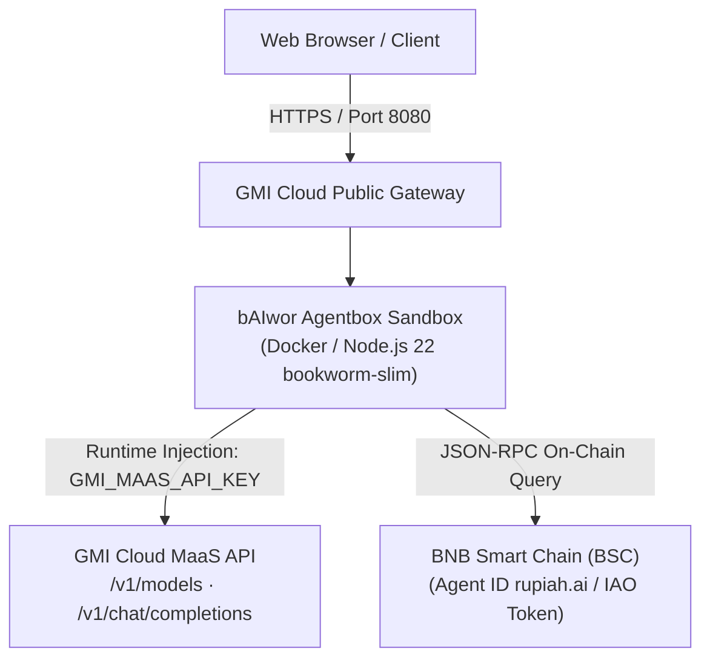

# 🎭 bAIwor Agentbox

<p align="left">
  
  
  
  
</p>

> *"Saka Bawor dadi bAIwor — Jiwa Punakawan, Pikiran AI, Guardian Banyumas lan Web3 Copilot"*  
> **Official Website:** [https://baiwor.my.id](https://baiwor.my.id) · **GMI Cloud:** [https://gmicloud.ai](https://gmicloud.ai)

```text
     ╭───▲───╮                                   PT. bAIwor Agentic Indonesia
   ▄▀▀   │   ▀▀▄     ██████╗  █████╗ ██╗██╗    ██╗ ██████╗ ██████╗     ██████╗  ██████╗ ██╗  ██╗
 ( (O) ( o ) (O) )   ██╔══██╗██╔══██╗██║██║    ██║██╔═══██╗██╔══██╗    ██╔══██╗██╔═══██╗╚██╗██╔╝
 ▄███████████████▄   ██████╔╝███████║██║██║ █╗ ██║██║   ██║██████╔╝    ██████╔╝██║   ██║ ╚███╔╝ 
 █ █ █ █ █ █ █ █ █   ██╔══██╗██╔══██║██║██║███╗██║██║   ██║██╔══██╗    ██╔══██╗██║   ██║ ██╔██╗ 
  ▀███████████▀    ██████╔╝██║  ██║██║╚███╔███╔╝╚██████╔╝██║  ██║    ██████╔╝╚██████╔╝██╔╝ ██╗
     ╰───┴───╯       ╚═════╝ ╚═╝  ╚═╝╚═╝ ╚══╝╚══╝  ╚═════╝ ╚═╝  ╚═╝    ╚═════╝  ╚═════╝ ╚═╝  ╚═╝
                          🎭 "Jiwa Punakawan, Pikiran AI, Guardian Banyumas"
```

---

## 🌟 Apa itu bAIwor Agentbox?

**bAIwor Agentbox** adalah agen Web3 & AI yang dirancang khusus untuk berjalan di atas lingkungan sandbox **GMI Cloud Agentbox v2**.

Agen ini menggabungkan dua kekuatan:
1. **GMI Cloud Models-as-a-Service (MaaS)**: Mengakses model penalaran terdepan dengan endpoint OpenAI-compatible (`https://api.gmi-serving.com/v1`) dan otomatisasi token lewat runtime injection `GMI_MAAS_API_KEY`. Daftar model diambil **live** dari `GET /v1/models` saat runtime, jadi model yang bisa dipilih selalu model yang benar-benar tersedia.
2. **On-Chain Intelligence (read-only)**: Membaca profil Agent ID (`rupiah.ai`), saldo gas BNB, dan saldo token **IAO** ([Ptah Trade](https://ptah.trade/iao)) di BNB Smart Chain (BSC) lewat JSON-RPC publik.

> **Batas yang disengaja:** tool Web3 di sini **read-only**. Tidak ada private key, tidak ada signing, tidak ada transaksi on-chain. Binance Agentic Wallet (`baw`) butuh login QR dari aplikasi Binance + keychain OS, yang tidak tersedia di dalam container sandbox — jadi ia **tidak** dipakai di sini. Semua angka di UI berasal langsung dari RPC saat runtime; kalau RPC tidak bisa dihubungi, UI menampilkan `—`, bukan angka tebakan.

---

## 🏗️ Arsitektur



| Endpoint | Fungsi |
| :--- | :--- |
| `GET /` | UI chat (HTML/CSS/JS statis, tanpa build step) |
| `GET /health` | Healthcheck + status key + model default |
| `GET /api/models` | Daftar model live dari GMI MaaS (di-proxy server, key tidak pernah ke browser) |
| `POST /api/chat` | Chat completion streaming (SSE), memakai key dari environment server |
| `GET /api/wallet` | Saldo BNB & IAO read-only + Agent ID |

---

## ⚠️ WAJIB: package GHCR harus PUBLIC sebelum Register

Package GHCR **default-nya private**, meskipun repository-nya public. Kalau package private, GMI Agentbox **gagal menarik image** saat launch (bukan saat Register — jadi error-nya muncul belakangan).

Langkah ini harus kamu kerjakan manual di browser:

1. Buka `https://github.com/orgs/bAIwor/packages` → paket **agentbox**
2. **Package settings** → **Change visibility** → **Public** → **Save**

Verifikasi (tanpa login, harus balas 200):

```bash
curl -s "https://ghcr.io/token?scope=repository:baiwor/agentbox:pull&service=ghcr.io"
curl -s -H "Authorization: Bearer <token-di-atas>" \
  https://ghcr.io/v2/baiwor/agentbox/tags/list
```

Alternatif: nyalakan **Requires sign-in** di form Register dan isi kredensial registry. Tapi token/PAT punya masa berlaku — kalau kedaluwarsa, agent mati sendiri. Public package lebih aman.

---

## 🚀 Cara Mendaftarkan Template di GMI Agentbox

Buka [GMI Cloud Console](https://console.gmicloud.ai/) → **Agentbox** → **Register an agent**:

| Kolom Form | Nilai Pengisian |
| :--- | :--- |
| **Deployment Mode** | `Host on GMI (DEFAULT)` |
| **Project Name** | `baiwor-agentbox-v1` |
| **Image URL** | `ghcr.io/baiwor/agentbox:latest` |
| **Requires Sign-in** | `OFF` — **hanya valid setelah package dibuat Public** |
| **Data Center** | `us-central-iowa16 — US` (atau pilihan Anda) |
| **Instance Type** | `Sandbox SMALL` (atau `MEDIUM`) |
| **Internal Port** | `8080` · Protocol `HTTPS/2` (default: eksternal 443 → internal 8080) |
| **Start Command** | **kosongkan** — `CMD` sudah ada di image |
| **Environment Variables** | `GMI_MAAS_API_KEY` → tipe **AUTO** (otomatis di-inject GMI) |
| | Opsional `DEFAULT_MODEL` → `deepseek-ai/DeepSeek-V3.2` |
| | Opsional `AGENT_ACCESS_TOKEN` → tipe **SECRET** (mengunci endpoint chat) |

Tiga hal yang hanya gagal **saat launch** (bukan saat Register): image tag sudah ter-push, Requires sign-in benar untuk image private, dan Internal Port cocok dengan port yang di-bind server.

### 🔒 Mengunci endpoint chat (opsional tapi disarankan)

Endpoint sandbox punya URL publik, dan siapa pun yang tahu URL itu bisa memakai kredit MaaS-mu. Set `AGENT_ACCESS_TOKEN` sebagai variabel **SECRET** di form Register, lalu buka UI dengan `?token=<token>` (token disimpan di localStorage browser) atau kirim header `X-Agent-Token`.

---

## 🐳 Syarat image

- **Wajib punya `bash`.** GMI menjalankan perintah sandbox lewat bash, sedangkan Alpine hanya punya busybox `ash`. Karena itu image ini memakai `node:22-bookworm-slim`, bukan `node:22-alpine`.
- **Wajib HTTP server persisten** yang listen di `0.0.0.0:8080` dan jawab health check.
- **`CMD`/`ENTRYPOINT` di-bake ke image** — jadi kolom Start Command di form Register dibiarkan kosong.

---

## 💻 Jalankan Lokal (Development)

```bash
# Clone repo
git clone https://github.com/bAIwor/agentbox.git
cd agentbox

# Install dependencies
npm install

# Buat berkas .env
cp .env.example .env

# Jalankan server
npm start
```

Kunjungi `http://localhost:8080` di peramban Anda.

Tanpa `GMI_MAAS_API_KEY`, UI tetap jalan: `/health` melaporkan `hasGmiKey: false`, `/api/models` memakai daftar fallback, dan `/api/chat` menolak dengan pesan jelas.

### Environment variables

| Variable | Default | Keterangan |
| :--- | :--- | :--- |
| `PORT` | `8080` | Port internal yang di-bind server |
| `GMI_MAAS_API_KEY` | – | Di-inject GMI saat deploy. **Jangan pernah** di-commit |
| `DEFAULT_MODEL` | `deepseek-ai/DeepSeek-V3.2` | Model ID default |
| `GMI_BASE_URL` | `https://api.gmi-serving.com/v1` | Endpoint MaaS |
| `BSC_RPC_URLS` | 4 endpoint publik (lihat `.env.example`) | Dipisah koma, dipakai berurutan sampai ada yang berhasil |
| `AGENT_ACCESS_TOKEN` | – | Kalau diisi, `/api/chat` butuh header `X-Agent-Token` |

### Model ID yang tersedia

Pakai ID yang **benar-benar ada** di katalog GMI Cloud. Yang dipakai di repo ini:

`deepseek-ai/DeepSeek-V3.2` · `deepseek-ai/DeepSeek-V3-0324` · `deepseek-ai/DeepSeek-R1-0528` · `deepseek-ai/DeepSeek-V4-Flash` · `deepseek-ai/DeepSeek-V3.1-Terminus`

Dropdown di UI diisi dari `GET /v1/models` saat runtime, jadi daftar ini cuma fallback.

---

## 🔄 Build & Publish

Setiap push ke `main` otomatis memicu GitHub Actions (`docker.yml`) yang build image `linux/amd64` lalu push ke GHCR dengan tag `latest` + `sha-<commit>`.

```bash
gh run list --repo bAIwor/agentbox
gh workflow run docker.yml --repo bAIwor/agentbox   # trigger manual
```

---

## 📄 Lisensi

Didistribusikan di bawah lisensi **MIT**. Hak Cipta © 2026 PT. bAIwor Agentic Indonesia.
