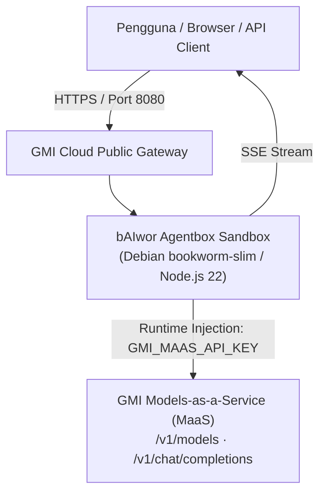

# 🎭 bAIwor Agentbox

<p align="left">
  <a href="https://gmicloud.ai/en/models/agentbox"></a>
  <a href="https://gmicloud.ai"></a>
  <a href="https://github.com/bAIwor/agentbox/pkgs/container/agentbox"></a>
  <a href="https://nodejs.org"></a>
  <a href="LICENSE"></a>
</p>

> *"Not an agent catalog. A launchpad for production-ready Agents."*  
> **Official Website:** [https://baiwor.my.id](https://baiwor.my.id) · **Platform Reference:** [GMI Agentbox Overview](https://www.gmicloud.ai/en/models/agentbox)

```text
     ╭───▲───╮                                   PT. bAIwor Agentic Indonesia
   ▄▀▀   │   ▀▀▄     ██████╗  █████╗ ██╗██╗    ██╗ ██████╗ ██████╗     ██████╗  ██████╗ ██╗  ██╗
 ( (O) ( o ) (O) )   ██╔══██╗██╔══██╗██║██║    ██║██╔═══██╗██╔══██╗    ██╔══██╗██╔═══██╗╚██╗██╔╝
 ▄███████████████▄   ██████╔╝███████║██║██║ █╗ ██║██║   ██║██████╔╝    ██████╔╝██║   ██║ ╚███╔╝ 
 █ █ █ █ █ █ █ █ █   ██╔══██╗██╔══██║██║██║███╗██║██║   ██║██╔══██╗    ██╔══██╗██║   ██║ ██╔██╗ 
  ▀███████████▀    ██████╔╝██║  ██║██║╚███╔███╔╝╚██████╔╝██║  ██║    ██████╔╝╚██████╔╝██╔╝ ██╗
     ╰───┴───╯       ╚═════╝ ╚═╝  ╚═╝╚═╝ ╚══╝╚══╝  ╚═════╝ ╚═╝  ╚═╝    ╚═════╝  ╚═════╝ ╚═╝  ╚═╝
                          🎭 "Jiwa Punakawan, Pikiran AI, Guardian Banyumas"
```

---

## 🌟 Apa itu bAIwor Agentbox?

**bAIwor Agentbox** adalah implementasi agen AI production-ready yang dibangun dan dikemas khusus mengikuti spesifikasi resmi [GMI Cloud Agentbox](https://www.gmicloud.ai/en/models/agentbox).

Alih-alih sekadar prototipe demo, repositori ini mengemas bAIwor sebagai agen workflow-specific yang siap dioperasikan, didistribusikan, dan diskalakan di atas infrastruktur terkelola GMI Cloud:

* **Satu Runtime, Satu Storefront, Fleksibel**: Berjalan di dalam sandbox mandiri (*isolated sandbox environment*) dengan latensi inferensi jaringan internal yang ultra-rendah.
* **Akses ke 200+ Model Frontier**: Terhubung ke ekosistem Models-as-a-Service (MaaS) GMI Cloud (seperti DeepSeek-V3, DeepSeek-R1, Llama 3) melalui runtime injection otomatis `GMI_MAAS_API_KEY`.
* **Zero Secret Leakage**: Tidak ada API key atau kredensial rahasia yang di-bake ke dalam image container. Autentikasi disuntikkan secara dinamis pada saat deploy (*runtime injection*).

---

## 🎯 3 Pilar Arsitektur GMI Agentbox

Sesuai panduan arsitektur [GMI Agentbox](https://www.gmicloud.ai/en/models/agentbox), bAIwor mengadopsi pola **Option 03: Compute + Models**:

| Opsi Adopsi | Peran Komputasi | Peran Model | Status bAIwor |
| :--- | :--- | :--- | :--- |
| **Option 01: Compute** | Dikelola GMI Sandbox | Bawa API model sendiri | Didukung |
| **Option 02: Models** | Dikelola pengguna di luar | GMI MaaS (200+ model) | Didukung |
| **Option 03: Compute + Models** | **Dikelola GMI Agentbox Sandbox** | **GMI MaaS End-to-End** | **Default / Rekomendasi Utama** |

---

## ⚡ Mendukung 3 Karakteristik Beban Kerja (Workloads)

Sesuai standar GMI Agentbox, bAIwor dirancang untuk menangani seluruh spektrum operasional:
1. **Ephemeral (Hitungan Detik)**: Spin up dan tear down dalam hitungan detik untuk batch processing, evaluasi koding cepat, dan pengujian otomatis.
2. **Long-Running (Menit hingga Jam)**: Menjaga state tugas interaktif, analisis dataset, atau riset komprehensif dengan pemanggilan model berlatensi rendah.
3. **Always-On (24/7)**: Beroperasi sebagai asisten digital persisten yang siap menerima perintah lewat Web UI (port 8080) atau integrasi API.

---

## 🏗️ Diagram Alur Sistem



---

## 🚀 4 Tahap Peluncuran Resmi (Deploy first. Launch when ready)

Mengikuti alur standar peluncuran di [GMI Console](https://console.gmicloud.ai/):

### 01. Deploy Private
Daftarkan template di GMI Console dengan konfigurasi berikut:

| Parameter Form | Nilai Rekomendasi |
| :--- | :--- |
| **Deployment Mode** | `Host on GMI (DEFAULT)` |
| **Project Name** | `baiwor-agentbox-v1` |
| **Image URL** | `ghcr.io/baiwor/agentbox:latest` |
| **Requires Sign-in** | `OFF` (Package GHCR bersifat Public) |
| **Data Center** | `us-central-iowa16 — US` |
| **Instance Type** | `Sandbox LARGE` (4 vCPU, 8 GiB RAM) atau `MEDIUM` |
| **Internal Port** | `8080` (Protocol: `HTTPS/2`) |
| **Start Command** | *(Biarkan kosong, sudah ada di Dockerfile)* |
| **Environment Variables** | `GMI_MAAS_API_KEY` (Tipe AUTO, otomatis dari GMI) |

### 02. Connect Models & Compute
Saat container pertama kali di-provisioning, GMI Cloud otomatis menyuntikkan token `GMI_MAAS_API_KEY` ke variabel lingkungan container. Server bAIwor langsung mendeteksi kunci ini dan menghubungkan streaming chat ke model frontier.

### 03. Validate & Publish
Uji kestabilan respon di endpoint publik GMI Anda:
* `/health` → Memverifikasi status hidup container dan ketersediaan key GMI.
* `/api/models` → Memverifikasi daftar model live dari katalog GMI.
* `/` → Antarmuka web chat responsif untuk interaksi langsung.

Setelah tervalidasi, ajukan listing ke **Agentbox Marketplace** agar pengguna lain dapat mendeploy instance bAIwor ke akun mereka dengan 1 klik.

### 04. Operate & Monitor
Pantau metrik penggunaan token, durasi aktif sandbox, dan operational log langsung dari dasbor terpadu GMI Cloud.

---

## 💵 Model Biaya Sandbox (Usage-Based Pricing)

GMI Agentbox menerapkan tarif komputasi murni berbasis durasi aktif tanpa biaya platform:
* **Small**: $0.0861 / jam (1 vCPU, 2 GiB RAM, 20 GB disk)
* **Medium**: $0.17 / jam (2 vCPU, 4 GiB RAM, 20 GB disk) — *Recommended*
* **Large**: $0.34 / jam (4 vCPU, 8 GiB RAM, 40 GB disk) — *Performa Maksimal*

> [!NOTE]
> **Ketentuan Early Access GMI:** Status **Paused Sandboxes** dan pembuatan template dikenakan tarif **$0 (GRATIS)** selama masa Early Access. Biaya komputasi hanya berjalan saat status container aktif (*Running*).

---

## 💻 Menjalankan Secara Lokal (Development)

```bash
# 1. Clone repositori
git clone https://github.com/bAIwor/agentbox.git
cd agentbox

# 2. Pasang dependensi
npm install

# 3. Buat berkas .env
cp .env.example .env

# 4. Jalankan server lokal
npm start
```

Buka `http://localhost:8080` pada peramban Anda.

---

## 📄 Lisensi

Didistribusikan di bawah lisensi resmi **MIT**. Hak Cipta © 2026 PT. bAIwor Agentic Indonesia.
