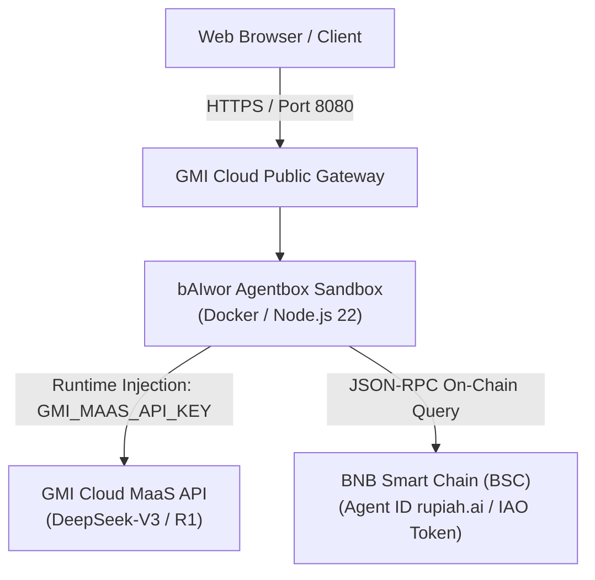

# 🎭 bAIwor Agentbox

<p align="left">
  
  
  
  
</p>

> *"Saka Bawor dadi bAIwor — Jiwa Punakawan, Pikiran AI, Guardian Banyumas lan Web3 Copilot"*  
> **Official Website:** [https://baiwor.my.id](https://baiwor.my.id) · **GMI Cloud:** [https://gmicloud.ai](https://gmicloud.ai)

```text
     ╭───▲───╮                                   PT. bAIwor Agentic Indonesia
   ▄▀▀   │   ▀▀▄     ██████╗  █████╗ ██╗██╗    ██╗ ██████╗ ██████╗     ██████╗  ██████╗ ██╗  ██╗
 ( (O) ( o ) (O) )   ██╔══██╗██╔══██╗██║██║    ██║██╔═══██╗██╔══██╗    ██╔══██╗██╔═══██╗╚██╗██╔╝
 ▄███████████████▄   ██████╔╝███████║██║██║ █╗ ██║██║   ██║██████╔╝    ██████╔╝██║   ██║ ╚███╔╝ 
 █ █ █ █ █ █ █ █ █   ██╔══██╗██╔══██║██║██║███╗██║██║   ██║██╔══██╗    ██╔══██╗██║   ██║ ██╔██╗ 
  ▀███████████▀    ██████╔╝██║  ██║██║╚███╔███╔╝╚██████╔╝██║  ██║    ██████╔╝╚██████╔╝██╔╝ ██╗
     ╰───┴───╯       ╚═════╝ ╚═╝  ╚═╝╚═╝ ╚══╝╚══╝  ╚═════╝ ╚═╝  ╚═╝    ╚═════╝  ╚═════╝ ╚═╝  ╚═╝
                          🎭 "Jiwa Punakawan, Pikiran AI, Guardian Banyumas"
```

---

## 🌟 Apa itu bAIwor Agentbox?

**bAIwor Agentbox** adalah agen otonom Web3 & AI yang dirancang khusus untuk berjalan di atas lingkungan sandbox **GMI Cloud Agentbox v2**.

Agen ini menggabungkan dua kekuatan frontier AI & Web3:
1. **GMI Cloud Models-as-a-Service (MaaS)**: Mengakses model penalaran terdepan (DeepSeek-V3, DeepSeek-R1, Llama 3.3) dengan latensi ultra-rendah dan otomatisasi token melalui runtime injection `GMI_MAAS_API_KEY`.
2. **Binance Agentic Wallet & On-Chain Intelligence**: Terintegrasi untuk membaca profil Agent ID (`rupiah.ai`), melacak portofolio gas token BNB, dan memantau status token ekosistem seperti **IAO** ([Ptah Trade](https://ptah.trade/iao)) di BNB Smart Chain (BSC).

---

## 🏗️ Arsitektur



---

## 🚀 Cara Mendaftarkan Template di GMI Agentbox

Buka [GMI Cloud Console](https://console.gmicloud.ai/) → **Agentbox** → **Register Template**:

| Kolom Form | Nilai Pengisian |
| :--- | :--- |
| **Deployment Mode** | `Host on GMI (DEFAULT)` |
| **Template Identifier** | `baiwor-agentbox-v1` |
| **Image URL** | `ghcr.io/baiwor/agentbox:latest` |
| **Requires Sign-in** | `OFF` (Public Image) |
| **Data Center** | `us-central-iowa16 — US` (atau default pilihan Anda) |
| **Instance Type** | `Small` (1 vCPU, 2 GiB RAM) atau `Medium` |
| **Internal Port** | `8080` (Protocol: `HTTPS/2` atau `HTTP/1.1`) |
| **Environment Variables** | `GMI_MAAS_API_KEY` (Otomatis di-inject oleh GMI saat deploy) |

---

## 💻 Jalankan Lokal (Development)

```bash
# Clone repo
git clone https://github.com/bAIwor/agentbox.git
cd agentbox

# Install dependencies
npm install

# Buat berkas .env
cp .env.example .env

# Jalankan server
npm start
```

Kunjungi `http://localhost:8080` di peramban Anda.

---

## 📄 Lisensi

Didistribusikan di bawah lisensi **MIT**. Hak Cipta © 2026 PT. bAIwor Agentic Indonesia.
