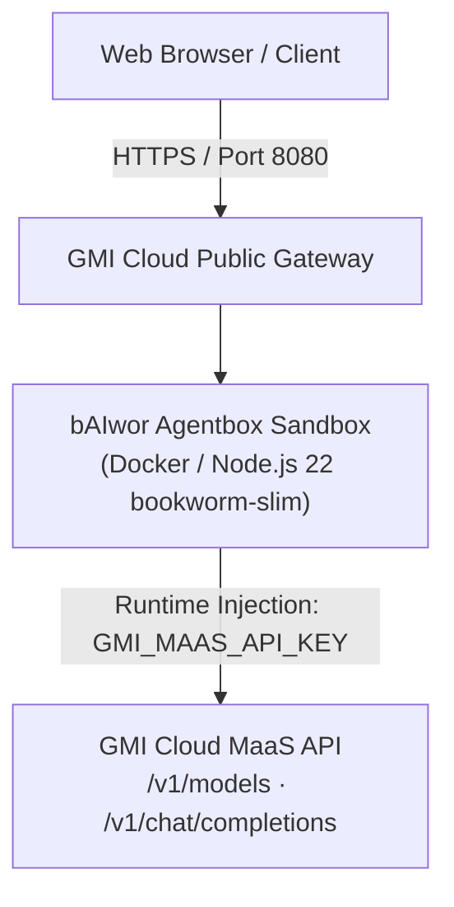

# 🎭 bAIwor Agentbox

<p align="left">
  
  
  
  
</p>

> *"Saka Bawor dadi bAIwor — Jiwa Punakawan, Pikiran AI, Guardian Banyumas"*  
> **Official Website:** [https://baiwor.my.id](https://baiwor.my.id) · **GMI Cloud:** [https://gmicloud.ai](https://gmicloud.ai)

```text
     ╭───▲───╮                                   PT. bAIwor Agentic Indonesia
   ▄▀▀   │   ▀▀▄     ██████╗  █████╗ ██╗██╗    ██╗ ██████╗ ██████╗     ██████╗  ██████╗ ██╗  ██╗
 ( (O) ( o ) (O) )   ██╔══██╗██╔══██╗██║██║    ██║██╔═══██╗██╔══██╗    ██╔══██╗██╔═══██╗╚██╗██╔╝
 ▄███████████████▄   ██████╔╝███████║██║██║ █╗ ██║██║   ██║██████╔╝    ██████╔╝██║   ██║ ╚███╔╝ 
 █ █ █ █ █ █ █ █ █   ██╔══██╗██╔══██║██║██║███╗██║██║   ██║██╔══██╗    ██╔══██╗██║   ██║ ██╔██╗ 
  ▀███████████▀    ██████╔╝██║  ██║██║╚███╔███╔╝╚██████╔╝██║  ██║    ██████╔╝╚██████╔╝██╔╝ ██╗
     ╰───┴───╯       ╚═════╝ ╚═╝  ╚═╝╚═╝ ╚══╝╚══╝  ╚═════╝ ╚═╝  ╚═╝    ╚═════╝  ╚═════╝ ╚═╝  ╚═╝
                          🎭 "Jiwa Punakawan, Pikiran AI, Guardian Banyumas"
```

---

## 🌟 Apa itu bAIwor Agentbox?

**bAIwor Agentbox** adalah agen AI otonom yang dikemas khusus untuk berjalan di lingkungan cloud sandbox **GMI Cloud Agentbox v2**.

Agen ini menghadirkan asisten cerdas berkepribadian Punakawan yang grapyak, trengginas, dan solutif untuk membantu kodingan, riset, penalaran mendalam, serta otomatisasi workflow.

### Fitur Utama:
1. **GMI Cloud Models-as-a-Service (MaaS)**: Terintegrasi langsung dengan model-model AI frontier (DeepSeek-V3, DeepSeek-R1, Llama 3) via low-latency API GMI Cloud.
2. **Runtime Key Injection**: Otomatis memanfaatkan `GMI_MAAS_API_KEY` yang di-inject oleh sandbox saat provisioning tanpa hardcoded credentials.
3. **Responsive Web Chat UI**: Antarmuka obrolan browser langsung di port 8080.
4. **Debian Bookworm-Slim Environment**: Memenuhi standar sandbox GMI Cloud yang mendukung eksekusi shell `bash`.

---

## 🏗️ Arsitektur



---

## 🚀 Cara Mendaftarkan Template di GMI Agentbox

Buka [GMI Cloud Console](https://console.gmicloud.ai/) → **Agentbox** → **Register an agent**:

| Kolom Form | Nilai Pengisian |
| :--- | :--- |
| **Deployment Mode** | `Host on GMI (DEFAULT)` |
| **Project Name** | `baiwor-agentbox-v1` |
| **Image URL** | `ghcr.io/baiwor/agentbox:latest` |
| **Requires Sign-in** | `OFF` (setelah package dibuat Public) |
| **Data Center** | `us-central-iowa16 — US` |
| **Instance Type** | `Sandbox LARGE` (atau `MEDIUM` / `SMALL`) |
| **Internal Port** | `8080` · Protocol `HTTPS/2` |
| **Start Command** | *(Kosongkan)* |
| **Environment Variables** | `GMI_MAAS_API_KEY` (Tipe AUTO, otomatis dari GMI) |

---

## 💻 Jalankan Lokal (Development)

```bash
# Clone repo
git clone https://github.com/bAIwor/agentbox.git
cd agentbox

# Install dependencies
npm install

# Buat berkas .env
cp .env.example .env

# Jalankan server
npm start
```

Kunjungi `http://localhost:8080` di peramban Anda.

---

## 📄 Lisensi

Didistribusikan di bawah lisensi **MIT**. Hak Cipta © 2026 PT. bAIwor Agentic Indonesia.
